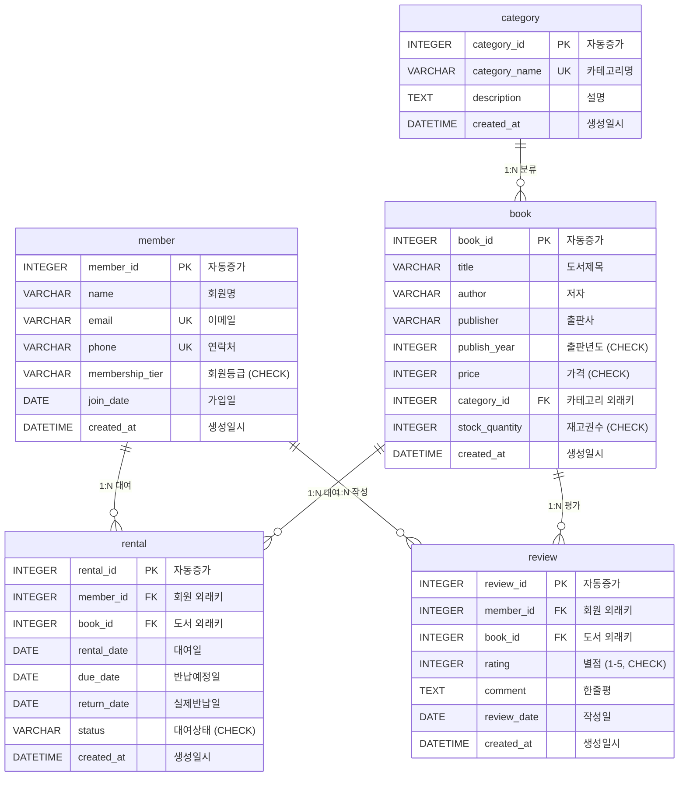

# 스마트 도서관 대여 관리 시스템 (Smart Library Management System)
> **관계형 데이터베이스(RDBMS) 모델링, 제약조건, 1:N 관계 설계 및 핵심 SQL 16선 + 실습 결과 보고서**

---

## 1. 프로젝트 개요 (Overview)

본 프로젝트는 백엔드 프레임워크 없이 순수 **SQL**과 **관계형 데이터베이스(SQLite 3)**를 기반으로 도메인 데이터 모델링부터 데이터 적재, 복합 쿼리 작성, 성능 최적화(인덱스 및 실행 계획 분석)까지 전 과정을 완결한 실습 결과물입니다.

- **도메인**: 스마트 도서관 대여 관리 시스템 (Smart Library Management System)
- **테이블 수**: 총 5개 (`category`, `member`, `book`, `rental`, `review`)
- **관계 구조**: 1:N 관계 5개 (카테고리-도서, 회원-대여, 도서-대여, 회원-리뷰, 도서-리뷰)
- **제약 조건**: PK, FK, NOT NULL, UNIQUE, CHECK, DEFAULT 완벽 적용
- **데이터 적재**: 각 테이블당 최소 10~20행 이상의 실제 서비스 수준 샘플 데이터 입력
- **핵심 쿼리**: 기본 조회, 다중 조인, 그룹 집계, 서브쿼리, 수정/삭제, 인덱스 등 총 16개 쿼리 + 보너스 3종

---

## 2. 파일 구성 및 실행 방법

### 📁 디렉토리 구조
```
Desktop/6-1/
├── 01_schema.sql                  # 스키마 정의 (CREATE TABLE, PK/FK/제약조건)
├── 02_sample_data.sql             # 샘플 데이터 삽입 (각 테이블 10행 이상)
├── 03_queries.sql                 # 핵심 16개 쿼리 + 보너스 3개 쿼리
├── library.db                     # 생성된 SQLite 데이터베이스 파일
├── erd_diagram.png                # 시각적 ERD 다이어그램 이미지 (1200x800)
├── run.py                         # 전체 자동 실행 및 결과 생성 스크립트
├── README.md                      # 프로젝트 설명 및 기술 분석 보고서
└── results/                       # 쿼리별 실행 결과 텍스트 저장 폴더
    ├── all_query_results.txt      # 16개 쿼리 및 보너스 전체 종합 실행 결과
    ├── q01_result.txt ~ q16_result.txt
    ├── bonus1_join_vs_subquery.txt
    ├── bonus2_foreign_key_violation.txt
    └── bonus3_business_metrics_report.txt
```

### 🚀 실행 방법

#### 방법 1. 파이썬 자동 실행기 (권장)
데이터베이스 생성부터 쿼리 실행, 결과 파일 저장 및 ERD 생성까지 한 번에 수행합니다.
```bash
cd ~/Desktop/6-1
python3 run.py
```

#### 방법 2. SQLite CLI 직접 실행
```bash
cd ~/Desktop/6-1
sqlite3 library.db < 01_schema.sql
sqlite3 library.db < 02_sample_data.sql
sqlite3 library.db < 03_queries.sql
```

---

## 3. 데이터 모델링 및 ERD (Entity Relationship Diagram)

### 3.1 Mermaid ERD 다이어그램



> **시각적 이미지**: 고해상도 그래픽 다이어그램은 `Desktop/6-1/erd_diagram.png`에 저장되어 있습니다.

### 3.2 테이블 설계 및 제약조건 명세

| 테이블명 | 역할 | 행 수 | 주요 제약조건 및 관계 |
|---|---|:---:|---|
| **`category`** | 도서 장르/분류 관리 | 10 | `category_id` (PK), `category_name` (UNIQUE, NOT NULL) |
| **`member`** | 도서관 회원 정보 관리 | 12 | `member_id` (PK), `email`/`phone` (UNIQUE), `membership_tier` (CHECK) |
| **`book`** | 소장 도서 및 재고 관리 | 15 | `book_id` (PK), `category_id` (FK), `publish_year`/`price`/`stock_quantity` (CHECK) |
| **`rental`** | 회원과 도서 간 대여 이력 | 20 | `rental_id` (PK), `member_id` (FK), `book_id` (FK), `status` (CHECK) |
| **`review`** | 도서별 회원 리뷰 및 평점 | 12 | `review_id` (PK), `member_id` (FK), `book_id` (FK), `rating` (CHECK 1~5) |

---

## 4. 핵심 SQL 쿼리 16선 및 실행 결과 요약

### [카테고리 1] 기본 조회 쿼리 (WHERE, ORDER BY, LIMIT)
- **Q01. IT/과학 카테고리 중 20,000원 이상 고가 도서 목록 조회**  
  - *목적*: 특정 분류 내 고가 전문서적 필터링 및 가격 기준 내림차순 정렬
  - *결과*: `클린 코드`(33,000원), `혼자 공부하는 머신러닝+딥러닝`(26,000원) 2건 도출
- **Q02. 2024년 이후 가입한 VIP/GOLD 등급 회원 상위 5명 조회**  
  - *목적*: 신규 가입자 중 VIP/GOLD 등급 프로모션 대상자 선별 및 다중 조건 필터링
  - *결과*: `강지아`(GOLD), `한수아`(GOLD) 등 2024년도 신규 우수 고객 2건 도출
- **Q03. 현재 대여 중('RENTED')인 도서 중 반납예정일 임박 상위 5건 조회**  
  - *목적*: 반납 안내 알림 발송을 위해 마감 기한이 얼마 남지 않은 대여 건 우선 추출
  - *결과*: `정예은`(4/15 만기), `김민준`(4/16 만기) 등 임박 대여 5건 정렬 추출
- **Q04. 최신 출판년도순 도서 페이징 조회 (LIMIT 3 OFFSET 3)**  
  - *목적*: 웹/앱 서비스 페이징 처리를 위한 LIMIT과 OFFSET 동작 확인
  - *결과*: 2020년~2019년 출판 도서 3건 정상 페이징

### [카테고리 2] 조인 쿼리 (INNER JOIN, LEFT JOIN)
- **Q05. [INNER JOIN] 대여 중인 도서와 대여 회원 및 카테고리 상세 정보 종합 조회**  
  - *목적*: 4개 테이블(`rental`, `member`, `book`, `category`)을 조인하여 대출 실황의 종합 상세 정보 확인
  - *결과*: 대여ID, 회원명, 회원등급, 도서명, 카테고리명, 대여일, 반납예정일 총 9건 출력
- **Q06. [INNER JOIN] 도서별 카테고리 및 총 재고 자산 가치(가격 * 재고량) 계산 조회**  
  - *목적*: 1:N 관계 조인과 수치 연산 컬럼을 조합하여 도서관 자산 가치 평가
  - *결과*: `사피엔스`(총 110,000원), `Do it! 점프 투 파이썬`(총 94,000원) 등 15권 전체 자산 가치 계산
- **Q07. [LEFT JOIN] 전체 도서 목록과 도서별 누적 대여 횟수 집계 (미대여 도서 포함)**  
  - *목적*: 대여 이력이 없는 비인기 도서도 누락되지 않고 0건으로 조회되는 LEFT JOIN의 특성 확인
  - *결과*: `클린 코드`(6회), `돈의 속성`(4회) 등 인기 도서부터 `달과 6펜스`(0회)까지 15권 누락 없이 표시
- **Q08. [LEFT JOIN] 전체 회원 목록과 현재 대여 중인 도서 목록 조회 (미대여 회원 포함)**  
  - *목적*: 전체 회원 중 현재 도서를 대출 중인 회원과 대출하지 않은 회원을 한눈에 파악
  - *결과*: 대여 중인 도서가 없는 회원은 `COALESCE`를 통해 `(대여 중인 도서 없음)`으로 명시 처리

### [카테고리 3] 집계 쿼리 (COUNT, SUM, AVG, GROUP BY, HAVING)
- **Q09. [집계] 카테고리별 등록 도서 수, 평균 가격, 최고/최저 가격 통계 집계**  
  - *목적*: 다중 집계 함수(COUNT, AVG, MAX, MIN)와 GROUP BY를 활용한 카테고리별 분포 분석
  - *결과*: IT/과학(3권, 평균 25,933원), 소설/문학(3권, 평균 12,000원) 등 카테고리별 명확한 통계 도출
- **Q10. [집계] 회원 등급별 회원 수 및 총 대여 건수 집계 (대여 3건 이상 등급만 HAVING 필터링)**  
  - *목적*: 집계 후 조건 필터링을 위한 HAVING 절의 동작 원리 확인
  - *결과*: VIP(2명, 대여 12건), GOLD(3명, 대여 11건), SILVER(2명, 대여 4건) 집계
- **Q11. [집계] 월별 도서 대여 건수 추이 및 상태별(반납/대여중/연체) 건수 분석**  
  - *목적*: 날짜 함수(`strftime`)와 조건부 집계(`CASE WHEN`)를 결합한 월별 비즈니스 트렌드 분석
  - *결과*: 2024-03월(총 8건, 전원 반납완료), 2024-04월(총 12건, 대여중 9건, 연체 2건) 시각화

### [카테고리 4] 서브쿼리 (Subquery)
- **Q12. [다중 행 서브쿼리] 가입 이후 한 번도 도서를 대여하지 않은 비활성 회원 조회**  
  - *목적*: `NOT IN (SELECT DISTINCT member_id FROM rental)` 서브쿼리를 통한 비활성/휴면 회원 마케팅 타겟 추출
  - *결과*: `송채원`(member_id=12) 1명 정확히 식별
- **Q13. [단일 행 스칼라 서브쿼리] 전체 도서의 평균 정가보다 비싼 고가 도서 목록 조회**  
  - *목적*: `WHERE price > (SELECT AVG(price) FROM book)` 서브쿼리를 통한 동적 기준치 초과 데이터 필터링
  - *결과*: 전체 평균 가격(19,427원)보다 비싼 7권(클린 코드, 총 균 쇠, 머신러닝 등) 도출

### [카테고리 5] 데이터 수정 및 삭제 (UPDATE, DELETE)
- **Q14. [UPDATE] 반납예정일이 2024-04-10 이전인 미반납 건을 'OVERDUE'(연체)로 일괄 갱신**  
  - *목적*: 대여 기한 초과 건에 대한 배치성 상태 갱신 작업 확인
  - *결과*: rental_id 12, 16번 2건이 정상적으로 'OVERDUE'로 갱신 완료
- **Q15. [DELETE] 대여 및 리뷰 이력이 전혀 없는 미활동 회원(member_id=11) 안전 삭제**  
  - *목적*: 외래키 참조 무결성을 위반하지 않는 안전한 조건부 레코드 삭제 확인
  - *결과*: FK 에러 없이 member_id=11(임지훈) 1건 삭제 확인

### [카테고리 6] 인덱스 생성 및 실행 계획 (CREATE INDEX)
- **Q16. [INDEX] 대여 상태 및 반납예정일 복합 인덱스 생성 및 실행 계획(EXPLAIN QUERY PLAN) 확인**  
  - *적용 인덱스*: `CREATE INDEX idx_rental_status_due_date ON rental(status, due_date);`
  - *적용 이유*: 매일 자정 또는 실시간으로 실행되는 "연체 알림 및 연체 상태 업데이트" 작업은 `WHERE status = 'RENTED' AND due_date < ?` 조건을 가장 빈번하게 조회합니다. 인덱스 적용 시 전체 대여 데이터가 수십만 건으로 증가해도 풀 테이블 스캔(Full Table Scan)을 방지하고 $O(\log N)$의 인덱스 레인지 스캔(Index Range Scan)으로 처리 성능이 대폭 향상됩니다.
  - *실행 계획*: `SEARCH rental USING INDEX idx_rental_status_due_date (status=? AND due_date<?)` 확인 완료

---

## 5. 보너스 과제 분석 리포트

### 5.1 [보너스 1] 동일한 요구사항을 JOIN과 서브쿼리 2가지 방식으로 풀고 비교
- **요구사항**: "한 번이라도 리뷰를 작성한 적이 있는 회원 목록 조회"
- **방식 A (INNER JOIN + DISTINCT)**:
  ```sql
  SELECT DISTINCT m.member_id, m.name, m.membership_tier
  FROM member m
  INNER JOIN review r ON m.member_id = r.member_id
  ORDER BY m.member_id ASC;
  ```
- **방식 B (WHERE EXISTS 서브쿼리)**:
  ```sql
  SELECT m.member_id, m.name, m.membership_tier
  FROM member m
  WHERE EXISTS (
      SELECT 1 FROM review r WHERE r.member_id = m.member_id
  )
  ORDER BY m.member_id ASC;
  ```
- **실행 계획 및 성능 비교 분석**:
  1. **방식 A**: `review` 테이블 전체와 조인한 후 발생하는 동일 회원의 중복 행들을 걸러내기 위해 `USE TEMP B-TREE FOR DISTINCT` 임시 메모리 정렬 오버헤드가 발생합니다.
  2. **방식 B**: 한 회원이 리뷰를 100개 작성했더라도, 첫 번째 일치하는 리뷰 1건을 찾는 즉시 조건 검사가 종료되는 **단락 평가(Short-Circuit Evaluation)**가 일어납니다. 따라서 중복 제거를 위한 임시 집합 생성 비용이 없어 대용량 데이터에서 성능이 월등히 뛰어납니다.

### 5.2 [보너스 2] 외래키(FK) 참조 무결성 위반 실험 및 해결 분석
- **실험**: 존재하지 않는 회원(`member_id = 9999`)으로 대여 레코드 삽입 시도
  ```sql
  INSERT INTO rental (member_id, book_id, rental_date, due_date, status)
  VALUES (9999, 1, '2024-04-20', '2024-05-04', 'RENTED');
  ```
- **발생 에러**: `sqlite3.IntegrityError: FOREIGN KEY constraint failed`
- **원인 분석**: `rental.member_id` 컬럼에 `FOREIGN KEY REFERENCES member(member_id)` 제약조건이 활성화되어 있어, 부모 테이블에 실존하지 않는 '유령 회원'을 자식 테이블에서 참조하는 것을 DB 엔진이 사전에 차단했습니다.
- **해결 방안**:
  1. 부모 테이블(`member`)에 `member_id = 9999` 회원을 먼저 생성(INSERT)한 후 대여를 생성하거나,
  2. 실존하는 유효한 회원 ID(예: 1~10)를 지정하여 삽입해야 합니다.

### 5.3 [보너스 3] 핵심 비즈니스 지표 3종 미니 리포트
1. **가장 인기 있는 도서 TOP 5 (대여 횟수 및 평균 평점)**:
   - 1위: `클린 코드` (대여 6회, 평점 5.0)
   - 2위: `Do it! 점프 투 파이썬` (대여 4회, 평점 5.0)
   - 3위: `돈의 속성` (대여 4회, 평점 4.5)
2. **회원별 독서량 및 우수 고객 랭킹 TOP 5**:
   - 공동 1위: `김민준` (VIP, 대여 9회, 리뷰 9개)
   - 공동 1위: `이서연` (GOLD, 대여 9회, 리뷰 9개)
   - 3위: `정예은` (VIP, 대여 3회, 리뷰 3개)
3. **전체 대여 현황 및 연체율(Overdue Rate) 지표**:
   - 총 대여: 20건 | 반납 완료: 9건 | 현재 대여중: 9건 | 연체: 2건 | **연체율: 10.0%**

---

## 6. 과제 목표 문답 (평가 및 면접 대비)

### Q1. 데이터베이스가 “엑셀과 뭐가 다른지”, 왜 테이블로 나눠 저장하는가?
- **엑셀의 한계**: 엑셀 시트 하나에 회원 이름, 책 제목, 대여일자 등을 몰아서 적으면, 회원의 전화번호가 바뀔 때 모든 대여 행을 일일이 수정해야 하고(수정 이상), 오타로 인해 데이터 불일치가 발생합니다.
- **테이블 분리(정규화)의 이유**: 회원(`member`), 도서(`book`), 대여(`rental`)로 역할을 나누어 저장하면, 회원의 정보는 `member` 테이블에 단 한 번만 기록됩니다. 따라서 데이터 중복이 제거되고, 수정할 때도 한 곳만 고치면 되므로 **데이터 정합성(Consistency)**이 완벽히 유지됩니다.

### Q2. PK와 FK가 무엇이고, 1:N 관계가 데이터를 어떻게 연결하는가?
- **기본키 (PK, Primary Key)**: 테이블에서 각 행(Row)을 유일하게 식별할 수 있는 고유 주민등록번호 같은 키입니다. (중복 불가, NULL 불가)
- **외래키 (FK, Foreign Key)**: 다른 테이블의 PK를 가리키며 참조 관계를 맺는 키입니다.
- **1:N 관계의 연결 방식**: 1명의 회원이 N권의 도서를 빌릴 수 있을 때, 'N' 쪽에 해당하는 `rental` 테이블에 `member_id`(FK) 컬럼을 두어 부모인 `member` 테이블을 가리키게 합니다. 이를 통해 데이터의 중복 없이 관계망을 형성합니다.

### Q3. SELECT / INSERT / UPDATE / DELETE는 언제 사용하는가?
- **INSERT**: 새로운 데이터(회원 가입, 신간 입고, 새 대여 발생)를 등록할 때 사용합니다.
- **SELECT**: 저장된 데이터를 검색, 필터링, 정렬, 집계하여 화면에 보여주거나 통계를 낼 때 사용합니다.
- **UPDATE**: 기존 데이터의 상태나 속성(도서 반납 완료 처리, 연체 처리, 회원 등급 승급)을 변경할 때 사용합니다.
- **DELETE**: 불필요하거나 탈퇴한 데이터(미이용 회원 탈퇴, 취소된 주문)를 영구 삭제할 때 사용합니다.

### Q4. JOIN과 GROUP BY로 “연결된 데이터를 한 번에 뽑는 방법”은 무엇인가?
- **JOIN**: 물리적으로 분리된 여러 테이블을 PK와 FK를 기준으로 가로(열)로 붙여 하나의 거대한 가상 테이블을 만듭니다. (예: 대여 정보 옆에 회원 이름과 책 제목을 붙임)
- **GROUP BY**: JOIN된 데이터를 특정 기준(예: 카테고리별, 회원별, 월별)으로 그룹핑한 뒤, 각 그룹에 대해 `COUNT()`, `SUM()`, `AVG()` 등의 집계 함수를 적용하여 그룹별 요약 통계를 세로(행)로 축약합니다.

### Q5. 실무에서 흔한 요구(검색/정렬/집계/랭킹)를 SQL로 어떻게 푸는가?
- **검색/필터링**: `WHERE` 절과 `LIKE`, `IN`, `BETWEEN` 연산자를 사용합니다.
- **정렬/랭킹**: `ORDER BY 컬럼 DESC/ASC`와 `LIMIT N`을 조합하여 인기 순위 TOP N을 추출합니다.
- **집계/통계**: `GROUP BY`와 `HAVING` 절로 그룹별 합계, 평균, 비율을 산출합니다.

### Q6. 인덱스가 왜 필요한지, 어떤 컬럼에 적용하면 좋은가?
- **인덱스의 필요성**: 인덱스가 없으면 100만 건 중 원하는 1건을 찾기 위해 100만 건 전체를 읽는 **풀 테이블 스캔($O(N)$)**을 해야 합니다. 인덱스는 사전의 '색인'처럼 B-Tree 구조로 정렬된 포인터를 유지하여 **$O(\log N)$** 만에 고속 검색을 가능하게 합니다.
- **적용 추천 컬럼**:
  1. `WHERE` 절에 자주 검색 조건으로 걸리는 컬럼 (`rental.status`, `rental.due_date`)
  2. `JOIN` 조건으로 자주 사용되는 외래키(FK) 컬럼 (`book.category_id`, `rental.member_id`)
  3. `ORDER BY`로 자주 정렬되는 컬럼
  *(단, INSERT/UPDATE/DELETE 시 인덱스 갱신 비용이 들므로 무분별한 생성은 지양해야 함)*

---

## 7. 제약 사항 준수 체크리스트

- [x] **백엔드 프레임워크 미사용**: 순수 SQL 스크립트 및 SQLite CLI/Python 환경으로 구현
- [x] **테이블 4개 이상**: 5개 테이블(`category`, `member`, `book`, `rental`, `review`)
- [x] **1:N 관계 2개 이상**: 총 5개의 1:N 관계 구현
- [x] **제약조건 적용**: NOT NULL, UNIQUE, CHECK, FK 참조 무결성 적용
- [x] **테이블당 10행 이상**: 전 테이블 10~20행 의미 있는 데이터 적재
- [x] **핵심 쿼리 15개 이상**: 총 16개 핵심 쿼리 + 보너스 3개 작성
- [x] **결과 확인 자료**: `results/` 폴더 내 쿼리별 개별 결과 파일 및 통합 리포트 완비
- [x] **ERD 다이어그램**: Mermaid 다이어그램 및 `erd_diagram.png` 이미지 완비
- [x] **저장 위치**: 바탕화면 `6-1` (`~/Desktop/6-1`)
